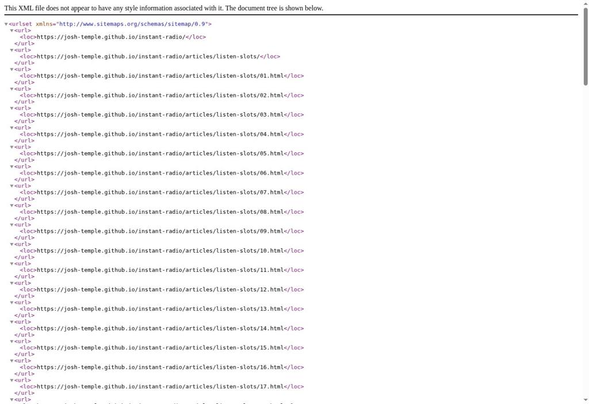
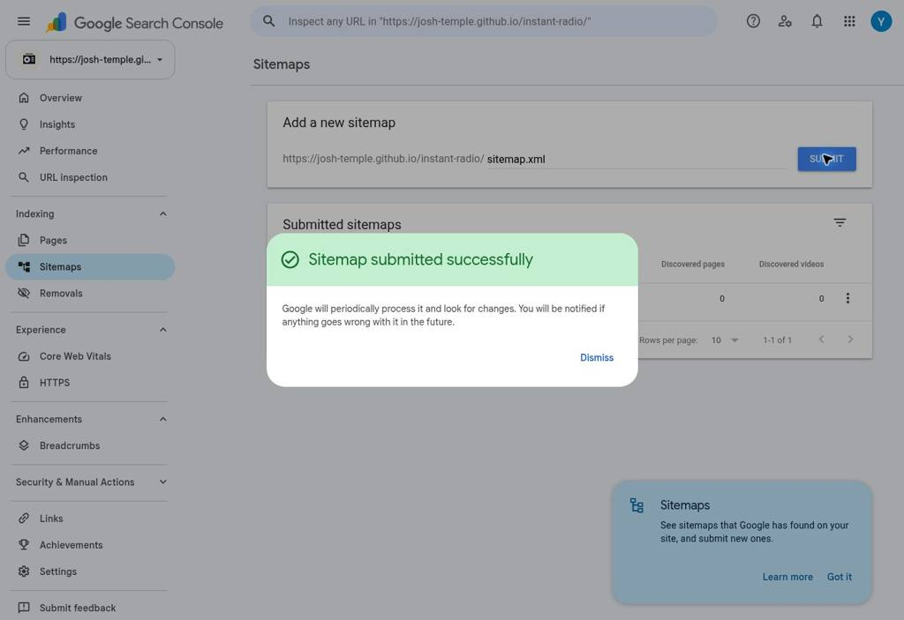
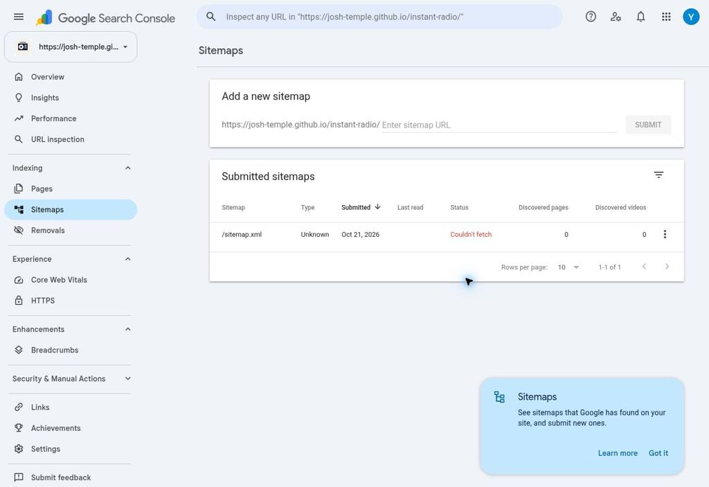
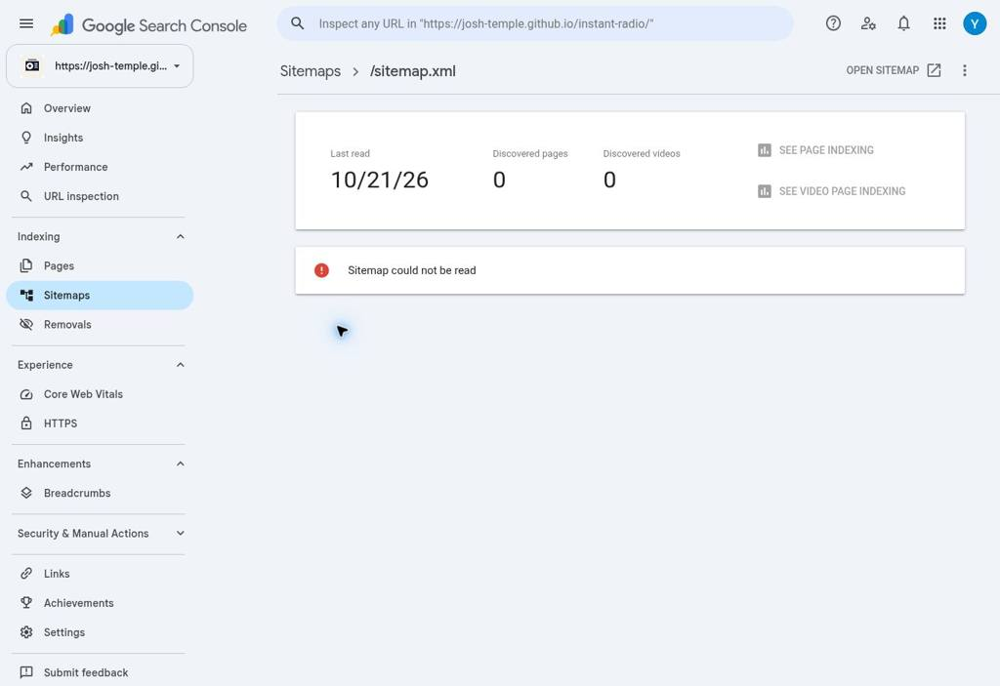
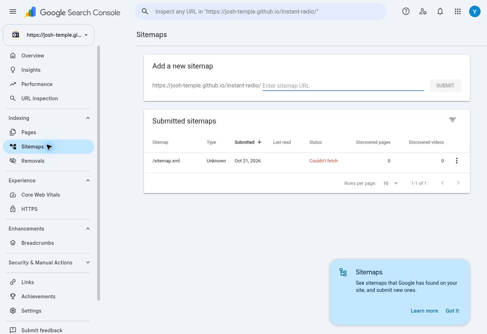
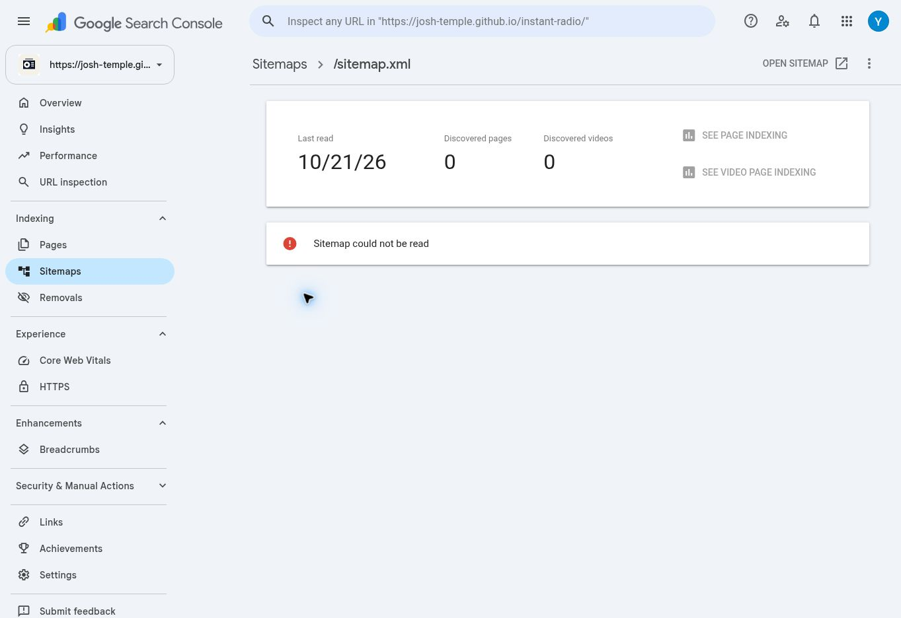

# Google Search Console サイトマップ提出 — 全100スロット展開

日付：2026-10-21 JST
Repository: `Josh-Temple/instant-radio`
対象プロパティ：`https://josh-temple.github.io/instant-radio/`

## 対象と変更範囲

Googleに大量URLを発見してもらうため、GitHub Pagesのプロジェクトルートに新規 `sitemap.xml` を配置する。

公開予定URL：`https://josh-temple.github.io/instant-radio/sitemap.xml`

- 102 URL: トップページ `/instant-radio/`、読み物一覧 `/instant-radio/articles/listen-slots/`、固定記事 `/instant-radio/articles/listen-slots/01.html`〜`100.html` の100件。
- URLは既存 `articles/listen-slots/registry.json` の`public_url`から取得。01・07・91〜100を含む。重複なし。
- Googleの正式XMLサイトマップ形式。各`loc`は同じプロパティ内のcanonical想定の絶対HTTPS URL。`/instant-radio/index.html`の重複表記は載せず、トップページは`/instant-radio/`を採用。
- `lastmod`は公開された記事の実際の最終重要更新日時がURLごとに確認できないため付けない。`priority` / `changefreq`も付けない。
- 実験用URL、非公開ワークスペース、アプリの内部ルート、対照実験用の別名URLは載せない。
- `robots.txt`は追加しない。プロジェクトページ内の`/instant-radio/robots.txt`はホスト直下の`/robots.txt`と異なり、標準robots発見経路にならないため。
- 記事HTML、canonical、スロット登録状況、PWA、Vercel、既存READMEは変更しない。

Google公式根拠：https://developers.google.com/search/docs/crawling-indexing/sitemaps/build-sitemap

## 掲載目的と実験への影響

2026-10-21のslot07単独介入では、07へのGSC `REQUEST INDEXING`受理後に、Google Index登録とユーザー実機Chrome標準音声再生の両方が確認された。slot01は当時GSC未登録・実機読み上げ不可の**無処置対照**だった。詳細は`docs/chrome-read-aloud-gsc-slot07-intervention-2026-10-21.md`。

**このサイトマップ公開・提出は01を含む全100スロットへの新たな一括発見促進介入である。** したがって、この時点から01を「一切Googleへの働きかけをしていない継続対照群」と呼ぶことはできない。ただし、01への*個別インデックス登録リクエスト*は引き続き未実施。

サイトマップ提出後、01もGoogleにインデックス登録され、Chrome標準読み上げが有効になるかを追跡する。07の再申請はしない。個別URL申請とサイトマップ提出の作用は異なり、同じ速さ／同じ結果になることは保証されない。登録済み／未登録と音声読み上げ可能／不可の状態を独立に測定し、因果と相関を混同しない。

## リリース受入チェック

1. GitHubで`main`の差分確認：`sitemap.xml`（新設）と本ドキュメント以外が変更されないこと。
2. 102件・重複0件・`01.html`から`100.html`の欠番なし・有効なXML・正しいベースURLを確認。
3. GitHub Pages本番反映後、`https://josh-temple.github.io/instant-radio/sitemap.xml` を匿名HTTP GET。HTTP 200、XML `urlset`、102件の`loc`が読めることを確認。未確認なら本番公開は未確認と報告。
4. **Work Cloud BrowserのGoogle Search Console**で対象プロパティを選択し、左メニューの「サイトマップ / Sitemaps」に移動。`sitemap.xml`（プロパティプレフィックスからの相対パス）を**1回**送信。
5. 送信結果・検出URL数・Googleが取得した日時・エラー・操作時刻（JST）・証拠画面を記録。すでに同じサイトマップが登録済みなら重複送信せず状態確認だけ行う。
6. 今後、Google Index上の01・07・他の代表スロット（例02、08、50、100）の状態と、ユーザーによるAndroid Chromeネイティブメニュー・本文音声再生の実測を、別々の観測として記録。

**重要：** GitHubにサイトマップが公開されても、Google Search Consoleに「送信済み」とは限らない。GSCに受理されたとしても、各URLのクロール・Google検索Index登録・Chrome標準読み上げの有効化は保証されない。

## 今回の作業ログ

- サイトマップのGitHub追加と検証：GitHub PR/mergeで実行・確認。
- GSCでのサイトマップ提出と取得状況：下記「GSC提出実測」を参照。提出受理・Googleによる読取・URL発見を区別して記録。
- 過去のslot07単独介入ログは書き換えず、観測時点の意味を保つ。

## GSC提出実測（2026-10-21 JST）

### 公開サイトマップの確認

- Cloud Browserで対象URLを開き、XMLツリーを表示。取得時刻は19:47:11.310 JST。文書型は application/xml、標準名前空間の urlset を表示し、parsererror は0件。
- Cloud Browser上のDOMで url 102件、loc 102件、重複なしを確認。01.html と100.htmlを含み、先頭はプロジェクトトップ、末尾は100.html。
- 同URLへの匿名HTTP GETは19:57:37 JSTに 200 OK、Content-Type application/xml、本文10,071 bytes。
- XMLを表示した画面： [サイトマップ画面](evidence/instant-radio-sitemap-xml-20261021.jpg)

### Search Consoleの提出と取得状況

- 対象プロパティ： https://josh-temple.github.io/instant-radio/
- 提出直前の Submitted sitemaps は 0-0 of 0。既存登録がなかったため、重複送信ではない。
- 19:55:09.146 JST、相対パス sitemap.xml を一度だけ送信。個別URLのインデックス登録リクエストは行っていない。
- 19:55:22.018 JSTに “Sitemap submitted successfully” を確認。
- 一覧画面（19:55:41.797 JST）： /sitemap.xml、Type Unknown、Submitted Oct 21, 2026、Status “Couldn't fetch”、Discovered pages 0、Discovered videos 0。詳細画面では Last read 列は空欄に見えた。
- 詳細画面（19:56:48.644 JST）： Last read は 10/21/26（時刻は表示されない）、Discovered pages 0、Discovered videos 0、状態は “Sitemap could not be read”。
- 取得エラーの詳細理由は画面に表示されなかった。

### 解釈と実施範囲

GSCはサイトマップの提出を受理したが、この確認時点でGoogleによる正常な取得・読取は確認できず、検出ページ数は0。公開URLがHTTP 200でXMLとして読めることと、Google側の取得・読取結果は別の観測である。提出成功を、102 URLの発見・個別URLのクロール・Google Index登録完了と同一視しない。特にslot01を含む100記事が現時点でGoogleに発見・登録されたとは確認できていない。

サイトマップ提出は100記事への一括発見シグナルとなるが、slot01への個別インデックス登録リクエストは未実施。記事HTML、canonical、登録情報、PWA、Vercelは変更していない。過去のslot07単独介入記録も書き換えていない。

### 画面証拠

Cloud Browserで表示したXML先頭（slot01を含む）：

Search Consoleの提出受理画面：

提出一覧の取得状態と検出数：

詳細画面の最終読取日とエラー：

## 2026-10-26 サイトマップ再検査（再提出なし）

ChatGPT Work Cloud Browserで既存の提出一覧と詳細を確認。2026-10-26 11:35〜11:36 JST、詳細証拠保存11:36:23 JST（操作側UTC時計から換算）。

- 対象：`https://josh-temple.github.io/instant-radio/sitemap.xml`
- 一覧：Type Unknown、Submitted Oct 21, 2026、Last read空欄、Status **Couldn't fetch**、Discovered pages **0**、videos **0**。
- 詳細：Last read **10/21/26**（時刻・タイムゾーン表示なし）、Discovered pages **0**、videos **0**、**Sitemap could not be read**。
- それ以上のエラー理由は詳細画面に表示されなかった。原因は未特定。
- 10月21日の失敗状態から正常読取へ移行したことは確認できない。今回、公開XMLへのHTTP再取得やライブURLテストは実施していない。
- 再提出・削除・サイトマップや記事の変更、個別Index申請は実施していない。

01・07・09のGoogle Index検査と読み上げ報告の照合は、[同日追補](chrome-read-aloud-gsc-slot07-intervention-2026-10-21.md)を参照。09はGSC上未登録のため、09の正常音声再生を検索Index登録済みと同一視しない。

## 2026-10-27 取得失敗の原因調査（削除・再提出なし）

### 公開応答と提出先

- 匿名GET：2026-10-27 01:03:25 JST、HTTP 200、Content-Type `application/xml`、10,071 bytes。別のcurl GETでも200・リダイレクト0回を確認。
- 公開本文はmain `d6f76e96e818424269786bbf21bd3feed8d35aa6` のsitemap.xmlとバイト一致。SHA-256 `ad20d71b6f6e9378bd661ba40c2b33f93a483ccf0f1223edaa2e7da2d0dbc120`。
- XMLパース成功、urlsetの名前空間は `http://www.sitemaps.org/schemas/sitemap/0.9`。102 loc・重複0・全URLが対象プロパティ内。掲載先のローカル公開ファイルに欠落なし。100記事＋トップ＋一覧という既存の構成と一致する。
- GSC詳細URLのsitemapパラメーターは `https://josh-temple.github.io/instant-radio/sitemap.xml`。一覧の `/sitemap.xml` はホスト直下への誤提出ではなく、このプロパティ内URLの表示だった。
- ホスト直下 `https://josh-temple.github.io/robots.txt` は01:03:43 JST、404。ログイン要求、匿名GETの403/429、X-Robots-Tag、リダイレクト障害は今回の応答では認めない。404のrobots.txtはそれ自体クロール禁止ではない（[Google公式](https://developers.google.com/search/blog/2025/03/robotstxt-flexible-way-to-control)）。過去やGooglebot別経路の応答まで保証しない。
- 応答には `Cache-Control: max-age=600`、通常のGitHub Pages CDNヘッダーがある。これだけで数日間のGoogle側失敗や読み上げ旧本文の原因とは判断できない。Last-Modifiedもデプロイ時刻のため、記事重要更新時刻と同一視しない。

### GSCの保存済み提出状態とライブ取得

提出詳細は引き続き **Sitemap could not be read**、Last read **10/21/26**、検出ページ0・動画0。一覧はCouldn't fetch / Unknown。展開可能な追加エラー項目や具体的HTTPエラーは表示されなかった。

原因の切り分けとして、公式手順に沿い**サイトマップURLそのものの公開URLライブテスト**も実施した。これはサイトマップの再提出や個別インデックス登録申請ではない。

- 画面表示：2026-10-27 01:04:19 AM（JST時計と整合）。Google Inspection Tool smartphone、Crawl allowed Yes、Page fetch **Successful**、Indexing allowed Yes。
- View tested pageはSOURCEタブでXML宣言・正しいurlset名前空間・プロジェクトトップ・01〜23を含むlocを表示。公開XMLの内容と整合する。Google取得全文のバイト保存はclipboard空のため未達。
- この成功は現在のGoogle検査経路がXMLを取得できる証拠。**サイトマップ処理系の取得・パース成功や102 URLの発見完了の証拠ではない。** Sitemap自体の検索Index登録は必要条件ではなく、画面のPage can be indexedをサイトマップ処理完了と読み替えない。

### 仮説ごとの評価

| 仮説 | 証拠と評価 | 未確認事項 |
| --- | --- | --- |
| XML構文・名前空間・掲載URLの誤り | 公開XMLはパース成功、102件整合。支持する証拠なし | Googleサイトマップ処理系のパースログ |
| 誤ったURL・プロパティへ提出 | 詳細URLで正しい完全URLを確認。支持されない | なし（今回の提出レコードの範囲） |
| 現在の恒常的な認証・robots・取得ブロック | 匿名200とGoogleライブSuccessful。支持されない | Googlebotと検査ツールの経路差・過去の応答 |
| 提出時の一時的取得障害、その失敗表示の継続 | Last readが10/21のまま、現在ライブ成功と整合 | 初回失敗のHTTP/DNS/TLS記録、再試行履歴 |
| Google側の処理待ち・レポート更新遅延 | 現在の取得成功と旧失敗表示の併存に整合 | サイトマップ処理ジョブの実行・内部状態 |

**根本原因は未特定。現状を「Google側の不具合」と断定しない。** 取得失敗レコードと現在のGoogleライブ取得成功を分けて記録する。GitHub PagesのGooglebotアクセスログやGSC内部処理ログは取得できていないため、過去の取得経路を確定できない。

### 推奨対応と公式根拠

XMLやサイト設定の修正は不要と判断する（修正すべき欠陥を今回確認できないため）。まず現在の提出レコードを保ち、Last read・状態・検出数を再確認する。ただし、**待てば必ず解消するとは言えない**。

[Google公式Sitemaps report](https://support.google.com/webmasters/answer/7451001?hl=en)は、ライブURL検査のPage fetch成功でアクセスを試験する手順を示す。一方、取得失敗後は数日再試行し、失敗が続けば停止する場合があるとしている。今回それが停止したかは確認できない。失敗が続く場合は、このライブ成功の証拠を添えてGoogle側へ照会し、既存URLの再提出を**別途判断**する。再提出には再取得を促す期待があるが、処理成功・Index登録・Chrome更新は保証できず、無介入観測にも影響する。今回の禁止事項に従い、削除・再提出はしていない。

### 証拠

- [提出詳細・10/21の失敗](evidence/ir-sitemap-detail-20261027.jpg)
- [Googleライブ取得成功](evidence/ir-sitemap-live-20261027.jpg)
- [Google取得XML SOURCE](evidence/ir-sitemap-source-20261027.jpg)
- [匿名HTTPのヘッダー・XML検査・ハッシュ](evidence/ir-http-20261027.json)

07/09の比較と固定URL再利用の評価は[同日追補](chrome-read-aloud-gsc-slot07-intervention-2026-10-21.md)を参照。Googleライブ成功をChrome音声更新や検索登録完了の証拠にはしていない。

## 2026-10-27 サイトマップ再提出・直後の観測

対象プロパティと登録済み完全URLは `https://josh-temple.github.io/instant-radio/` および `https://josh-temple.github.io/instant-radio/sitemap.xml`。Cloud Browserで詳細URLを確認。公開XMLは匿名GETでHTTP 200、XML解析成功、loc 102件・重複0件。

| 項目 | 再提出前 | 再提出直後 |
| --- | --- | --- |
| 一覧の提出日 | Oct 21, 2026 | Oct 27, 2026 |
| 一覧の最終読取日 | 空欄 | 空欄 |
| 詳細の最終読取日 | 10/21/26 | 10/27/26 |
| 状態 | Couldn't fetch | Couldn't fetch |
| 詳細 | Sitemap could not be read | Sitemap could not be read |
| 検出ページ / 動画 | 0 / 0 | 0 / 0 |

操作側時計で2026-10-27 13:59:40 JSTに `sitemap.xml` を一度だけ送信。GSCは **Sitemap submitted successfully** と応答。登録削除なし。詳細の新しい日付は表示されたが時刻・タイムゾーンは表示されず、処理の正確な時刻や失敗原因は分からない。画面には追加の具体的理由がない。

**再提出受理・取得成功未確認。** 直後の失敗表示が今後も続くかは未確認。提出受理、サイトマップの正常読取、URL発見、個別URLのIndex登録は別の事象。公開GET成功はGoogleサイトマップ処理の成功を示さない。根本原因は引き続き未特定。

次回は別の実行として、一覧の提出日・状態・検出ページ／動画数、詳細の最終読取日とエラーを上記と比較する。時間経過後に更新される可能性はあるが成功を保証しない。01・07・09のIndexやChrome読み上げを評価する際には、この再提出を全102 URLへの発見促進を意図した介入として時系列に含める。今回、個別Index申請や記事・XML・canonical・registry・PWA・Vercelの変更は行っていない。

- [再提出前の詳細](evidence/ir-gsc-before-resubmit-20261027.jpg)
- [送信受理](evidence/ir-gsc-resubmit-accepted-20261027.jpg)
- [再提出後の詳細](evidence/ir-gsc-after-resubmit-20261027.jpg)
